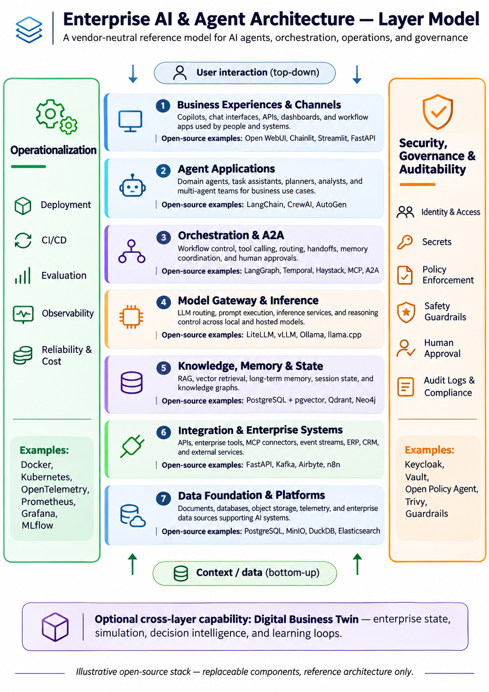

# AI-A01 — Enterprise AI Reference Architecture

## 1. Project Overview

**Project ID:** AI-A01  
**Category:** AI Architecture  
**Duration:** 3 days  
**Status:** In Progress

### Objective

Design and validate a vendor-neutral Enterprise AI Reference
Architecture supporting AI agents, orchestration, enterprise
integration, knowledge, inference, governance, and operations.

The architecture uses seven functional layers and two
cross-cutting pillars.

## 2. Architecture Layer Model

### Seven Architecture Layers

| Layer | Name | Open-Source Examples |
|---|---|---|
| 1 | Business Experiences & Channels | Open WebUI, Chainlit, Streamlit |
| 2 | Agent Applications | LangChain, CrewAI, AutoGen |
| 3 | Orchestration & A2A | LangGraph, Temporal, A2A |
| 4 | Model Gateway & Inference | LiteLLM, Ollama, vLLM |
| 5 | Knowledge, Memory & State | PostgreSQL, pgvector, Qdrant, Neo4j |
| 6 | Integration & Enterprise Systems | MCP, FastAPI, Kafka, n8n |
| 7 | Data Foundation & Platforms | PostgreSQL, MinIO, DuckDB |

### Cross-Cutting Pillars

**Operationalization**
- Deployment and infrastructure
- CI/CD
- Evaluation and testing
- Observability and monitoring
- Reliability, performance and cost

**Security, Governance & Auditability**
- Identity and access management
- Policy enforcement
- Secrets management
- AI safety and guardrails
- Human oversight and approvals
- Audit trails and compliance

## 3. Architecture Principles

1. Vendor-neutral and open-source-first
2. Modular, loosely coupled components
3. API-first integration
4. Model independence
5. Security and governance by design
6. Observable and auditable agent execution
7. Human oversight for consequential actions
8. Scalable from local prototype to enterprise platform

## 4. Practical Demonstration

Build a small Enterprise Operations Assistant that:

1. Receives a business request.
2. Routes the request to an AI agent.
3. Retrieves relevant enterprise knowledge.
4. Uses an LLM through a model gateway.
5. Accesses synthetic enterprise data through an API.
6. Generates a recommendation.
7. Applies governance and approval controls.
8. Records execution traces and results.

## 5. Three-Day Project Plan

### Day 1 — Architecture Design
- Define requirements and architecture principles.
- Finalize the seven-layer reference model.
- Create context and container diagrams.
- Identify component responsibilities and interfaces.

### Day 2 — Architecture Prototype
- Select the minimal open-source stack.
- Build an end-to-end vertical slice.
- Integrate local model inference.
- Add knowledge retrieval and enterprise API access.

### Day 3 — Validation and Documentation
- Test the prototype.
- Review security and governance.
- Capture execution traces.
- Document architecture decisions.
- Finalize diagrams and README.
- Commit and push to GitHub.

## 6. Expected Deliverables

- Architecture layer infographic
- C4 system context diagram
- C4 container diagram
- Deployment architecture diagram
- Component and technology catalogue
- Architecture Decision Records (ADRs)
- Working proof of concept
- Validation and test results
- GitHub repository

## 7. Project Structure

a-01-enterprise-ai-architecture/
- README.md
- diagrams/
- docs/
- src/
- tests/

## 8. Success Criteria

AI-A01 is complete when the reference architecture is
documented, the principal components and interfaces are
defined, and a small end-to-end AI agent workflow has
been demonstrated and validated.

Subsequent projects A02–A08 will extend this architecture.
